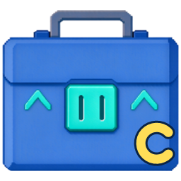
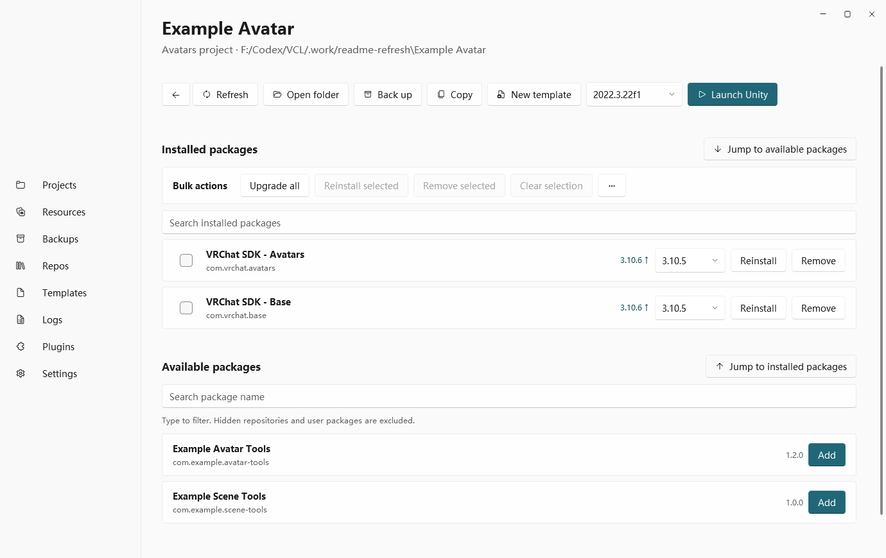

  
  <h1>VCL Canary</h1>
  
A Windows manager for VRChat projects and VPM packages. Based on <a href="https://github.com/VRLearn-Official/VRCLearn_Launcher">VRCLearn Launcher</a> by VRLearn and maintained independently by AKaNecoo.

  **[Download](https://github.com/AKaNecoo/VCL-Canary/releases/latest)** · [Report an issue](https://github.com/AKaNecoo/VCL-Canary/issues) · [简体中文](README.md) · [日本語](README.ja.md)

## VCL Canary highlights

- **Project package management**  Manage installed and available packages in one searchable list. Install or upgrade selected packages, upgrade all packages to newer stable versions, or use the more menu to include prereleases or reinstall all packages with a known source at their locked versions.
- **In-app updates.** Subscribe to the stable, Beta, or Alpha channel. Once an eligible update has downloaded, install it right away or on the next launch.
- **In-app plugin catalog.** Open **Plugins → Browse plugins** to find extensions, check compatibility, and download and install them.
- **Archive with external local packages (experimental).** Enable the feature in Settings to preview and include directly referenced local UPM package directories or `.tgz` packages in an archive. The launcher removes the original project directory after verifying the archive.

VCL Canary also manages VPM repositories and dependencies, creates and opens Unity projects, backs up and restores projects, organizes local `.unitypackage` files, supports project templates and local plugins, and handles `vcc://` links. The interface is available in Simplified Chinese, Traditional Chinese, English, and Japanese.

## Screenshot

## Install and update

Use **Download** above to get and run `VRCLearnLauncher-<version>-win-x64-Setup.exe`. VCL Canary supports Windows 10 or later on x64.

Check for updates in **Settings → About**. If in-app updates are unavailable, run the latest installer over your existing installation.

## Development and contributions

[Build from source and project layout](docs/development.md) · [Plugin development guide](docs/plugins.md)

## License

[MIT](LICENSE) · [Third-party notices](THIRD-PARTY-NOTICES.txt)

VCL Canary is an independently maintained community fork. It has no affiliation with VRChat Inc. or Unity Technologies.
