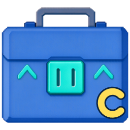
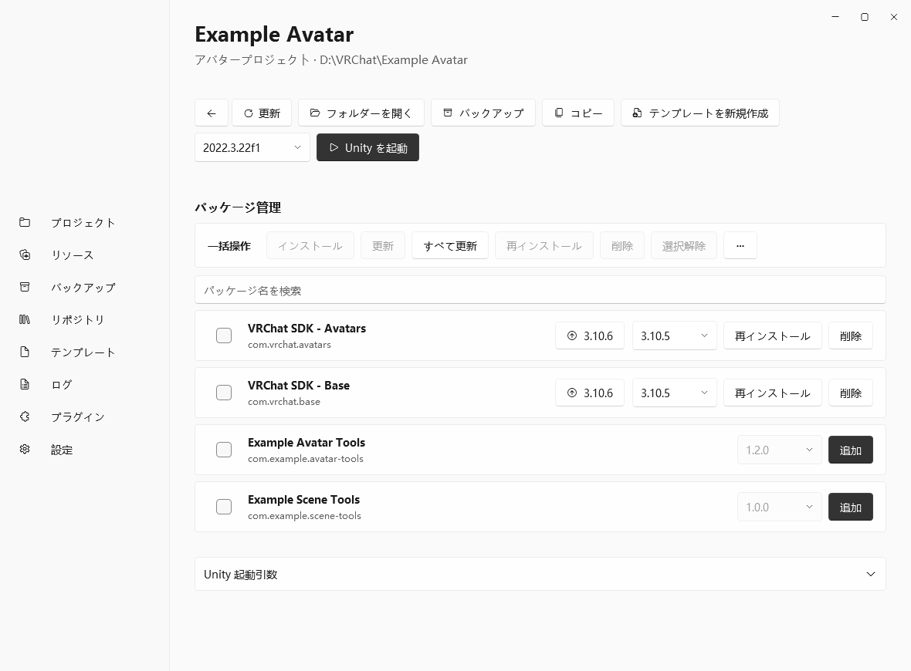

  
  <h1>VCL Canary</h1>
  
Windows で VRChat プロジェクトと VPM パッケージを管理するツールです。VRLearn が開発した <a href="https://github.com/VRLearn-Official/VRCLearn_Launcher">VRCLearn Launcher</a> をベースに、AKaNecoo が独立してメンテナンスしています。

  **[ダウンロード](https://github.com/AKaNecoo/VCL-Canary/releases/latest)** · [不具合を報告](https://github.com/AKaNecoo/VCL-Canary/issues) · [简体中文](README.md) · [English](README.en.md)

## VCL Canary の特徴

- **プロジェクトのパッケージ管理**　インストール済み・インストール可能なパッケージを、共通の検索欄がある一つの一覧で管理できます。選択したパッケージのインストール・更新、安定版への一括更新に対応し、その他メニューからプレリリース版を含む更新や、取得元がある全パッケージの固定バージョンでの再インストールも行えます。
- **アプリ内更新**　安定版、Beta、Alpha から更新チャンネルを選べます。アプリ内更新に対応したインストーラーをダウンロードした後は、すぐに更新するか、次回起動時にインストールできます。
- **アプリ内プラグインカタログ**　「プラグイン → プラグインを探す」から拡張機能を検索し、互換性を確認してダウンロード・インストールできます。
- **外部ローカルパッケージを含めるアーカイブ（実験的）**　設定で有効にすると、プロジェクトが直接参照する外部のローカル UPM パッケージフォルダーや `.tgz` を確認して、アーカイブに含めることができます。元のプロジェクトフォルダーはアーカイブの検証後に削除されます。

VPM リポジトリと依存関係の管理、Unity プロジェクトの作成・起動・バックアップ・復元、ローカルの `.unitypackage` の整理にも対応しています。プロジェクトテンプレート、ローカルプラグイン、`vcc://` リンクを利用できます。表示言語は簡体字中国語、繁体字中国語、英語、日本語です。

## スクリーンショット

## インストールと更新

ページ上部の「ダウンロード」から `VRCLearnLauncher-<バージョン>-win-x64-Setup.exe` を入手して実行してください。Windows 10 以降の x64 に対応しています。

「設定 → このアプリについて」から更新を確認できます。アプリ内で更新できない場合は、最新版のインストーラーで上書きインストールしてください。

## 開発とコントリビュート

[ソースからのビルドとプロジェクト構成](docs/development.md) · [プラグイン開発ガイド](docs/plugins.md)

## ライセンス

[MIT](LICENSE) · [サードパーティーのライセンス](THIRD-PARTY-NOTICES.txt)

VCL Canary は独立してメンテナンスされているコミュニティ版です。VRChat Inc. および Unity Technologies との提携はありません。
