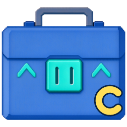
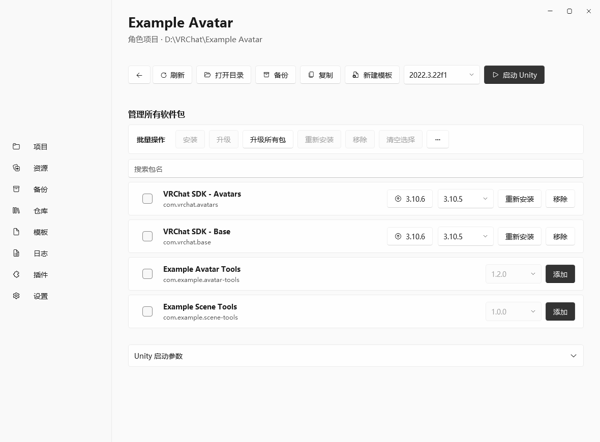

  
  <h1>VCL Canary</h1>
  
适用于 Windows 的 VRChat 项目与 VPM 软件包管理器。基于 VRLearn 开发的 <a href="https://github.com/VRLearn-Official/VRCLearn_Launcher">VRCLearn Launcher</a>，由 AKaNecoo 独立维护。

  **[下载](https://github.com/AKaNecoo/VCL-Canary/releases/latest)** · [问题反馈](https://github.com/AKaNecoo/VCL-Canary/issues) · [English](README.en.md) · [日本語](README.ja.md)

## VCL Canary 的特色

- **项目软件包管理**　已安装和可安装的软件包在同一个列表中管理，共用搜索框。支持安装、升级所选包，以及升级全部稳定版；更多菜单提供预发布版升级和按锁定版本重新安装所有有来源的软件包。 空间不足时，部分批量操作会收进「…」菜单。
- **应用内更新**　可订阅正式版、Beta 或 Alpha。支持应用内安装的更新下载完成后，可立即安装或留到下次启动时安装。
- **应用内插件市场**　从「插件 → 浏览插件」搜索扩展、查看兼容性并下载安装。
- **归档时包含外部本地软件包（实验性）**　在设置中启用后，可在归档时预览并打包项目直接引用的外部本地 UPM 目录包或 `.tgz` 包。归档校验通过后才会移除原项目目录。

也支持管理 VPM 仓库和软件包依赖、新建和启动 Unity 项目、备份与还原、管理本地 `.unitypackage`、使用项目模板、安装本地插件和接收 `vcc://` 链接。界面支持简体中文、繁体中文、英文和日文。

## 截图

## 安装与更新

点击页首「下载」，获取并运行 `VRCLearnLauncher-<版本>-win-x64-Setup.exe`。支持 Windows 10 或更高版本的 x64 系统。

在「设置 → 关于」检查更新。应用内更新不可用时，可下载新版安装包覆盖安装。

## 开发与贡献

[源码构建与项目结构](docs/development.md) · [插件开发指南](docs/plugins.md)

## 许可

[MIT](LICENSE) · [第三方许可](THIRD-PARTY-NOTICES.txt)

VCL Canary 是独立维护的社区分支，与 VRChat Inc. 和 Unity Technologies 无隶属关系。
